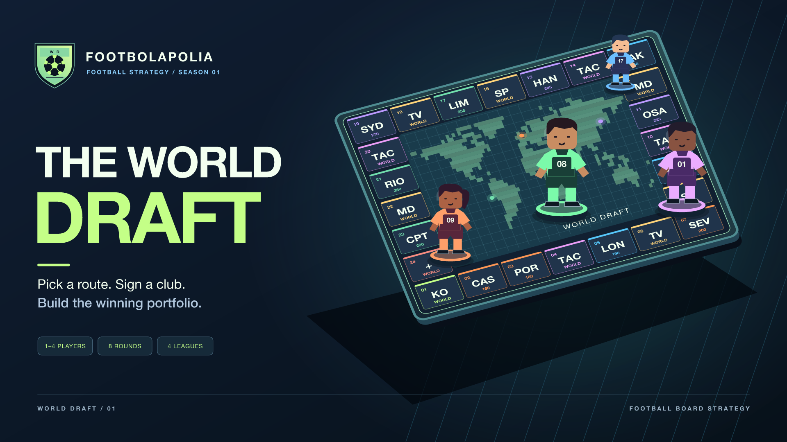

# Footbolapolia: The World Draft



**Footbolapolia** — футбольная настольная стратегия для Roblox. На рельефной карте мира игроки выбирают маршруты, подписывают клубы, собирают лиги и улучшают стадионы. Побеждает менеджер с самым ценным составом после восьми раундов.

## Запуск за минуту

1. Откройте `dist/Footbolapolia.rbxl` в **Roblox Studio**. Если у вас только исходники, сначала выполните `make build`.
2. Нажмите **Play** (не Run). 3D-поле появится при запуске. Выберите футболиста и нажмите **Начать сезон / Start season**. Соло сразу заполняется двумя ботами; за одним столом поддерживается до четырёх человек.
3. Выберите один из двух подсвеченных маршрутов (клавиши **1 / 2** или касание), затем подпишите клуб, если это выгодно. Три клуба одной лиги удваивают сборы на её клетках. В финале сравниваются деньги, клубы, вложения в стадионы и бонусы полных лиг.

Кнопки «Правила» и «Клубы» доступны во время партии. В правилах можно переключить EN/RU, отключить звук или сократить анимацию. Матчевые кредиты не связаны с Robux и сбрасываются после сезона.

## Что показать на собеседовании

- **Первые 45 секунд:** выбрать фигурку, показать 24 клетки и рельеф мира. Выбрать маршрут по его цене и последствиям. Покупку можно показать, когда один из ходов ведёт к свободному клубу.
- **Следующая минута:** открыть каталог, объяснить набор из трёх клубов и 8-раундовый горизонт; показать, почему часть кредитов нужно оставлять на следующий контракт. Навести на различия между соло и партией с друзьями.
- **Технический разговор:** чистая модель правил тестируется вне Roblox; сервер принимает только намерения игрока и владеет экономикой; клиенты рисуют состояние и движение. Просроченное или повторное действие не меняет баланс. Показать QA, Git историю, воронку и решение начать монетизацию с косметики.

Этот репозиторий — **играбельный вертикальный срез v0.1**, подготовленный для портфолио и закрытого теста. Публичного Roblox experience, реальных лицензий, платежей, постоянной прогрессии и данных живой аудитории в поставке нет.

## Сборка из исходников

Нужны Roblox Studio, [Rojo 7.7.1](https://github.com/rojo-rbx/rojo/releases/tag/v7.7.1) и для проверок [Luau CLI 0.747](https://github.com/luau-lang/luau/releases/tag/0.747): `luau`, `luau-compile`, `luau-analyze`. Положите их в PATH. Rojo можно установить через Rokit по `rokit.toml`.

```sh
make verify
rojo serve  # необязательно: подключить Rojo Plugin в собственной копии place
```

`make verify` компилирует исходники, проверяет типы чистой модели, запускает тесты и собирает place. Движковый код дополнительно проверяется в Studio. GitHub Actions повторяет быстрые проверки и публикует файл сборки как артефакт CI при подключении внешнего репозитория. Текущее хранилище — локальный Git.

```sh
python3 scripts/studio-qa.py --launchservices
python3 scripts/studio-qa.py --players 2 --launchservices
python3 scripts/studio-qa.py --device portrait --launchservices
python3 scripts/studio-qa.py --device landscape --launchservices
```

`--launchservices` запускает отдельную копию Studio через штатный macOS launcher. Двухклиентский режим Studio использует локальный временный серверный place в каталоге Roblox. Тесты копируют код в одноразовую сборку внутри `.tools`; тестовые скрипты не входят в релиз. Не запускайте одновременно несколько тестов Studio с локальным сервером.

## Документация

| Материал | Что внутри |
| --- | --- |
| [Дизайн](docs/GAME.md) | Правила, баланс, состав среза, контракты |
| [Рынок](docs/MARKET.md) | Данные Roblox, конкуренты, референс Wildberries, сегмент и план проверки |
| [Монетизация](docs/MONETIZATION.md) | Cosmetics Pass, сценарии DevEx и требования к обработке покупок |
| [Публикация](docs/RELEASE.md) | Studio → Creator Hub, закрытый тест, возрастной охват, критерии запуска |
| [QA](docs/QA.md) | Проверки, ограничения, следующие испытания |
| [Графика](art/README.md) | Исходники оформления, PNG, данные карты и происхождение ассетов |

## Как устроен проект


- `src/shared/` — неизменяемый каталог, геометрия клеток и правила без сетевого состояния.
- `src/server/` — создание арены, лобби, часы, RNG, валидация и аналитика.
- `src/client/` — управление, табло, модели фигурок, локализация, анимации.
- `scripts/` и `tests/` — генераторы, тесты и воспроизводимая сборка.

Игра использует оригинальные игровые названия и модели. Физическая настолка служит референсом формата. Карта: Made with Natural Earth.
