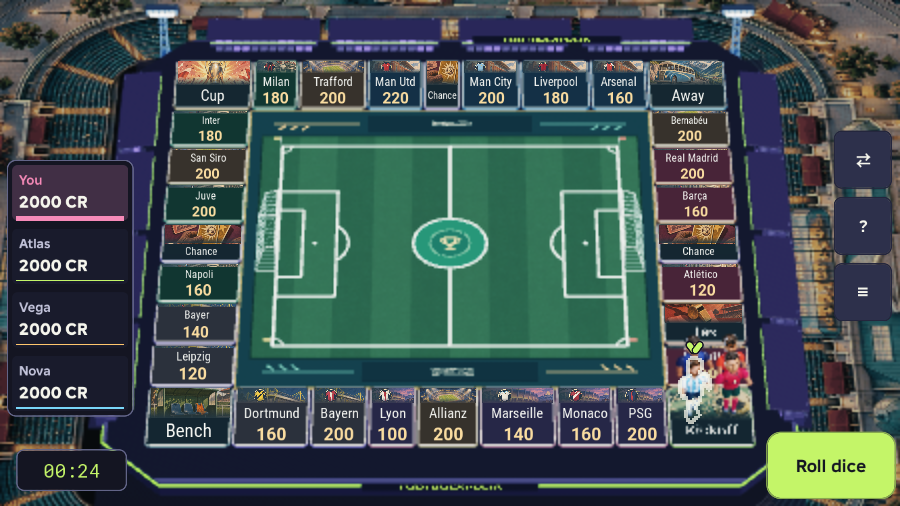
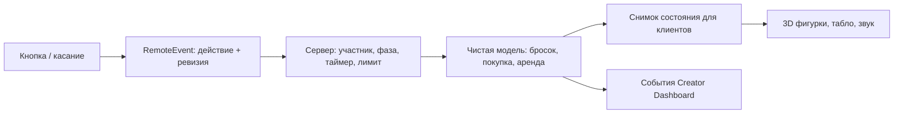

# Soccerpoly

**Soccerpoly** — футбольная стратегия на четверых. На 32 клетках расположены 20 клубов из пяти лиг, четыре стадиона и клетки событий. В одиночной партии свободные места занимают боты.

[Играть в Roblox](https://www.roblox.com/games/114770772027261/Soccerpoly) · [Инструкция для разработчика](docs/DEVELOPMENT.md) · [Скачать сборку для Studio](https://github.com/GlebAvershin/Soccerpoly/releases/download/v0.24.2/Soccerpoly-v0.24.2.rbxl)

## Запуск

1. Откройте скачанный `Soccerpoly-v0.24.2.rbxl` (или свою сборку `dist/Soccerpoly.rbxl`) в Roblox Studio и нажмите **Play**.
2. При первом запуске лобби открывается на английском. Выберите фигурку и начните матч. Бросьте два кубика. Сумма определит клетку, а дубль даст дополнительный бросок.
3. На свободном клубе выберите уровень постройки и подтвердите покупку. Нажмите на любую клубную клетку, чтобы открыть её цены, аренду и выкуп. Игра заканчивается при выполнении условия победы или по таймеру. Хост выбирает быстрый матч на 20 минут или длинный на 60.

Для переключения на русский нажмите **Language · EN** в лобби или откройте настройки языка в правилах во время партии. В правилах также можно включить сокращённую анимацию, отключить музыку или весь звук.

В портретном режиме матч открывается с видом на всё поле. Кнопка **Follow turn** («К ходу») включает камеру рядом с активной фигурой. **Full board** («Всё поле») возвращает обзор. [Поле на телефоне](art/studio-overview-ru-v0242.png).

## Что показать в портфолио

- Вечернюю арену с собственным знаком на газоне, телевизионное табло и [карточку покупки с выбором уровня](art/studio-property-v0220.png).
- [Фигурки в Blender](art/blender-lineup-v0200.png) и [удар по воротам](art/studio-goal-v0240.png) в игре.
- Покупку и выкуп после аренды. Полный серверный тест охватывает дубль, пропуск со скамейки, выездной тур, ликвидацию и три способа победы через собственность.
- [Разбор Business Tour через REA](docs/ART_DIRECTION.md) и [проверки](docs/QA.md). Прототип v0.11.0 и его эксперименты сохранены в Git.

## Сборка из исходников

Для первой сборки нужны Git, Rojo 7.7.1 и Roblox Studio. В инструкции есть команды для Windows и macOS, синхронизация правок со Studio, тест с двумя клиентами и диагностика запуска. [Настройка и разработка](docs/DEVELOPMENT.md)

При каждом push и pull request GitHub Actions собирает place и проверяет правила, контент и аналитику. [Прогоны CI](https://github.com/GlebAvershin/Soccerpoly/actions/workflows/quality.yml) · [Релизы](https://github.com/GlebAvershin/Soccerpoly/releases)

## Документация

| Материал | Что внутри |
| --- | --- |
| [Рабочее место разработчика](docs/DEVELOPMENT.md) | Установка, карта кода, первая правка и тесты |
| [Playrix](docs/PLAYRIX.md) | Покрытие двух вакансий, готовые артефакты и демонстрация |
| [Настольный референс и клубы](docs/REFERENCE.md) | Фото физической игры, рейтинг популярности и состав пяти лиг |
| [AI workflow](docs/AI_WORKFLOW.md) | Бриф, MCP, валидатор, компиляция контента и проверка |
| [Аналитика](docs/ANALYTICS.md) | A/B, SQL, Python, Jupyter, экономика и план подключения сервисов |
| [Руководство игрока](docs/GAME.md) | Первый ход, сделки, чемпионат и условия победы |
| [Арена и анимация](docs/ART_DIRECTION.md) | Визуальное направление, читаемость поля и показ событий |
| [Рынок](docs/MARKET.md) | Данные Roblox, конкуренты, референс Wildberries, сегмент и план проверки |
| [Монетизация](docs/MONETIZATION.md) | Cosmetics Pass, сценарии DevEx и требования к обработке покупок |
| [Публикация](docs/RELEASE.md) | Studio → Creator Hub, закрытый тест, возрастной охват, критерии запуска |
| [QA](docs/QA.md) | Проверки, ограничения, следующие испытания |
| [Графика](art/README.md) | Исходники оформления, PNG, данные карты и происхождение ассетов |

## Как устроен проект

- `src/shared/` — неизменяемый каталог, геометрия клеток и правила без сетевого состояния.
- `src/server/` — создание арены, лобби, часы, RNG, валидация и аналитика.
- `src/client/` — управление, табло, модели фигурок, локализация, анимации.
- `content/` — исходный двуязычный каталог Continental Cup.
- `analytics/` — события, SQL, Python, Jupyter, PySpark и Airflow.
- `native/` — C++17, STL и OpenGL inspector для баланса Matchday.
- `scripts/` и `tests/` — редактор контента, MCP, проверки и сборка.

На поле представлены реальные футбольные клубы. Физическая настолка служит референсом формата. В архивной обложке используется маска суши Natural Earth.
