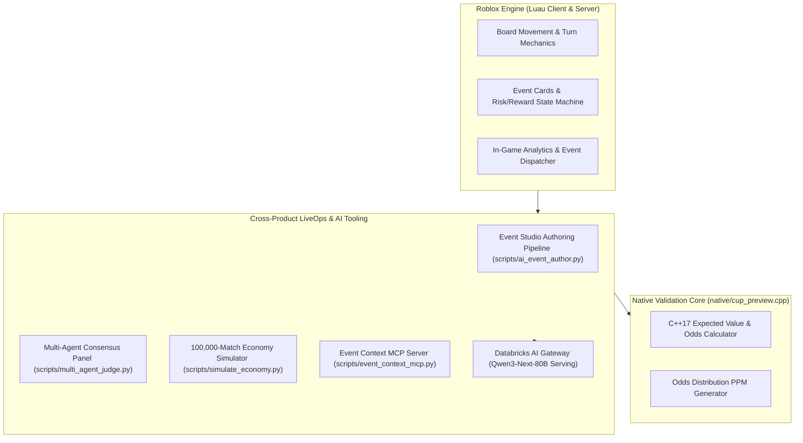

# Soccerpoly · Global Draft & LiveOps Football Strategy

<p align="center">
  
</p>

<p align="center">
  <a href="README.md"><b>English</b></a> •
  <a href="README.ru.md"><b>Русский</b></a>
</p>

<p align="center">
  
  
  
  
  
  
  
</p>

---

## 🎮 Play & Quick Links

* ⚽ **[Play on Roblox](https://www.roblox.com/games/114770772027261/Soccerpoly)** — Live published seasonal event (*Continental Cup v10*).
* 📦 **[Download Roblox Studio Place File](dist/Soccerpoly.rbxl)** — Ready-to-inspect `.rbxl` build.
* 📑 **[Engineering & LiveOps Architecture](docs/TECHNOLOGIES.md)** — C++17 odds inspector, 100k economy simulation, and model evaluations.
* 📱 **[Mobile UX & Screen Breakpoints QA](docs/QA.md)** — Portrait and landscape layout verifications.

---

## 📖 Overview

**Soccerpoly** is a turn-based multiplayer football board strategy on Roblox. Players buy football clubs, bid in auctions, build stadiums, and participate in high-stakes seasonal cups where every turn presents a critical risk/reward decision: take guaranteed safe payout or take a shot on goal with chance of loss.

For Playrix's **Cross-product** and **Game AI** tracks, Soccerpoly demonstrates an enterprise **LiveOps Event Authoring Pipeline**:
1. AI agents draft new seasonal events based on high-level themes (*Champions Derby*).
2. Deterministic mathematical validators ensure economic fairness before any content touches a game build.
3. Native C++17 modules independently verify goal probabilities and expected monetary values.
4. Macroeconomy stress testing checks for currency inflation across 100,000 matches.
5. A Multi-Agent consensus panel (LLM-as-a-Judge) reviews event UX and monetization.

---

## 🏗️ Technical Architecture



---

## 🔬 Key Engineering & AI Highlights

| Component | Technical Implementation | Empirical Verification |
| :--- | :--- | :--- |
| **LiveOps Event Studio** | AI-assisted authoring pipeline compiling bilingual JSON catalogues into Luau (`EventCards.luau`). | Strict invariants enforced: $79.17 \le \text{Safe Cash} (80) \le 124.17$ CR; Goal odds $\le 50.0\%$. |
| **Native C++17 Odds Engine** | Independent C++ calculator using STL to compute goal probability and expected monetary values. | Goal odds = **0.500**, EV Cash = **71.667 CR**, EV Portfolio = **111.667 CR**. Verified byte-for-byte. |
| **100k-Match Economy Stress Test** | Monte Carlo simulation of 10,000 players over a 14-day seasonal tournament with entry fees and trophy sinks. | **Faucet / Sink ratio: 1.0305 to 1.0407** (safe corridor: 1.00–1.15). Gini index: **0.39–0.42** (zero hyperinflation). |
| **Multi-Agent Judge Protocol** | Panel of 3 specialized agent personas (Economy, UX, Retention) powered by Databricks Model Serving. | Computed **PPRS Score (58.0/100)**; identified severe UX friction in -35 CR penalties and recommended streak mechanics. |
| **Context Protocol (MCP)** | Stdio MCP tool allowing agents to query event rules, calculate recommendations, and audit decks. | Exposes `recommend_cup_action(target)` tested across all 141 discrete credit thresholds. |

---

## 📊 Live Verification Benchmarks

### 1. Macroeconomy 100,000-Match Stress Test

| Metric | Continental Cup v1 | Champions Derby v1 (New LiveOps) | Target Threshold |
| :--- | :---: | :---: | :---: |
| Total Currency Created (Faucet) | 11,028,175 CR | 11,506,295 CR | — |
| Total Currency Sunk (Sink) | 10,701,445 CR | 11,056,640 CR | — |
| **Faucet / Sink Ratio (Inflation)** | **1.0305** | **1.0407** | **1.00 – 1.15 (Healthy)** |
| Gini Wealth Inequality Index | 0.4290 | 0.3910 | < 0.50 (Competitive) |
| Trophies Purchased | 56,182 | 51,042 | Strong progression drive |
| **Guardrail Status** | **PASSED** | **PASSED** | Zero inflation alerts |

### 2. LiveOps Discrete Action Recommendation (141 Thresholds)

```
Target Gap (CR) | Recommendation | Probability | Rule Rationale
----------------+----------------+-------------+-----------------------------------------------
1 - 75 CR       | Take Guarantee | 100%        | Safe payout (75 CR) covers target with zero risk
76 - 140 CR     | Take Shot      | 50% (3/6)   | Only goal shot (140 CR) can bridge the gap
141+ CR         | Defer Purchase | 0%          | Exceeds maximum single-turn payout
```

---

## 🛠️ Quickstart & Reproduction

### Validate Economic Invariants & Build Luau Catalog
```bash
python3 scripts/event_studio.py check
```

### Run C++17 Native Odds Calculator
```bash
python3 scripts/native_preview.py
```

### Run 100,000-Match Macroeconomy Stress Test
```bash
python3 scripts/simulate_economy.py
```

### Convene Multi-Agent LLM-as-a-Judge Panel
```bash
python3 scripts/multi_agent_judge.py
```

---

## 📁 Repository Structure

```
Soccerpoly/
├── content/                # Versioned seasonal event catalogs
│   ├── continental-cup.json# Shipped Continental Cup v1
│   └── champions-derby.json# AI-authored Champions Derby v1
├── native/                 # C++17 native verification modules
│   ├── cup_preview.cpp     # Expected value & probability calculator
│   └── Makefile            # Native build configuration
├── scripts/                # LiveOps authoring & simulation toolchain
│   ├── ai_event_author.py  # Generative AI pipeline with invariant enforcement
│   ├── simulate_economy.py # 100,000-match macroeconomy stress tester
│   ├── multi_agent_judge.py# Multi-agent LLM-as-a-Judge consensus suite
│   ├── event_studio.py     # Deterministic validator & Luau compiler
│   └── event_context_mcp.py# Model Context Protocol server
├── src/                    # Roblox Luau client and server source code
├── tests/                  # Game balance and simulation test suites
└── docs/                   # Production engineering documentation
    ├── TECHNOLOGIES.md     # In-depth empirical engineering dossier
    └── evidence/           # Raw JSON receipts, stress tests, and panel verdicts
```

---

<p align="center">
  <sub>Developed for the Playrix Cross-Product AI & Game AI Engineering tracks.</sub>
</p>
