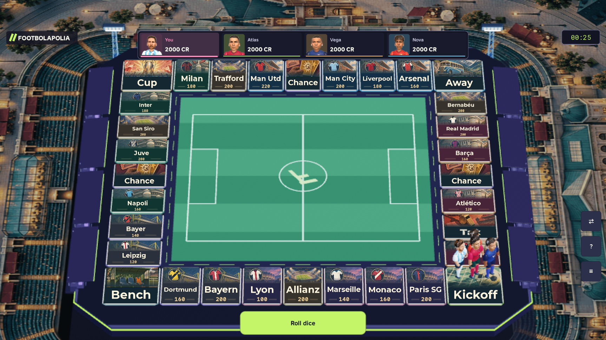
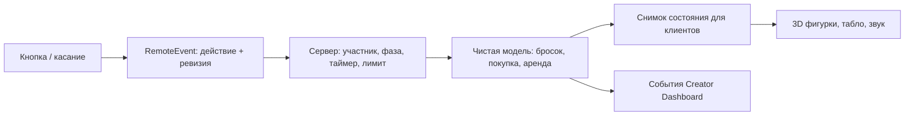

# Footbolapolia



**Footbolapolia** — футбольная стратегия на четверых. На 32 клетках расположены 20 клубов из пяти лиг, четыре стадиона и клетки событий. В одиночной партии свободные места занимают боты.

## Запуск

1. Откройте `dist/Footbolapolia.rbxl` в Roblox Studio и нажмите **Play**.
2. При первом запуске лобби открывается на английском. Выберите фигурку и начните матч. Бросьте два кубика. Сумма определит клетку, а дубль даст дополнительный бросок.
3. На свободном клубе выберите уровень постройки и подтвердите покупку. Нажмите на любую клубную клетку, чтобы открыть её цены, аренду и выкуп. Игра заканчивается при выполнении условия победы или по таймеру. Хост выбирает быстрый матч на 20 минут или длинный на 60.

Для переключения на русский нажмите **Language · EN** в лобби или откройте настройки языка в правилах во время партии. В правилах также можно включить сокращённую анимацию, отключить музыку или весь звук.

## Что показать в портфолио

- Вечернюю арену с собственным знаком на газоне, телевизионное табло и [карточку покупки с выбором уровня](art/studio-property-v0220.png).
- [Фигурки в Blender](art/blender-lineup-v0200.png) и [удар по воротам](art/studio-goal-v0200.png) в игре.
- Покупку и выкуп после аренды. Полный серверный тест охватывает дубль, пропуск со скамейки, выездной тур, ликвидацию и три способа победы через собственность.
- [Разбор Business Tour через REA](docs/ART_DIRECTION.md) и [проверки](docs/QA.md). Прототип v0.11.0 и его эксперименты сохранены в Git.

## Сборка из исходников

Нужны Roblox Studio, [Rojo 7.7.1](https://github.com/rojo-rbx/rojo/releases/tag/v7.7.1) и для проверок [Luau CLI 0.747](https://github.com/luau-lang/luau/releases/tag/0.747): `luau`, `luau-compile`, `luau-analyze`. Для `make verify` нужны также Python 3.9+ и компилятор C++17. Положите инструменты в PATH. Rojo можно установить через Rokit по `rokit.toml`.

```sh
make verify
rojo serve  # необязательно: подключить Rojo Plugin в собственной копии place
```

`make verify` компилирует исходники, проверяет каталог и типы Luau, запускает тесты, пересчитывает аналитические витрины, проверяет баланс через C++17 и собирает place. Движковый код дополнительно проверяется в Studio. GitHub Actions повторяет быстрые проверки и публикует файл сборки как артефакт CI при подключении внешнего репозитория. Текущее хранилище — локальный Git.

```sh
python3 scripts/studio-qa.py --launchservices
python3 scripts/studio-qa.py --art --matchday --launchservices
python3 scripts/studio-qa.py --players 2 --launchservices
python3 scripts/studio-qa.py --players 4 --launchservices
python3 scripts/studio-qa.py --device portrait --launchservices
python3 scripts/studio-qa.py --device landscape --launchservices
```

`--launchservices` запускает отдельную копию Studio через штатный macOS launcher. Двухклиентский режим Studio использует локальный временный серверный place в каталоге Roblox. Тесты копируют код в одноразовую сборку внутри `.tools`; тестовые скрипты не входят в релиз. Не запускайте одновременно несколько тестов Studio с локальным сервером.

## Документация

| Материал | Что внутри |
| --- | --- |
| [Playrix](docs/PLAYRIX.md) | Покрытие двух вакансий, готовые артефакты и демонстрация |
| [Настольный референс и клубы](docs/REFERENCE.md) | Фото физической игры, рейтинг популярности и состав пяти лиг |
| [AI workflow](docs/AI_WORKFLOW.md) | Бриф, MCP, валидатор, компиляция контента и проверка |
| [Аналитика](docs/ANALYTICS.md) | A/B, SQL, Python, Jupyter, экономика и план подключения сервисов |
| [Дизайн](docs/GAME.md) | Правила, баланс, состав среза, контракты |
| [Арена и анимация](docs/ART_DIRECTION.md) | Визуальное направление, читаемость поля и показ событий |
| [Рынок](docs/MARKET.md) | Данные Roblox, конкуренты, референс Wildberries, сегмент и план проверки |
| [Монетизация](docs/MONETIZATION.md) | Cosmetics Pass, сценарии DevEx и требования к обработке покупок |
| [Публикация](docs/RELEASE.md) | Studio → Creator Hub, закрытый тест, возрастной охват, критерии запуска |
| [QA](docs/QA.md) | Проверки, ограничения, следующие испытания |
| [Графика](art/README.md) | Исходники оформления, PNG, данные карты и происхождение ассетов |

## Как устроен проект



- `src/shared/` — неизменяемый каталог, геометрия клеток и правила без сетевого состояния.
- `src/server/` — создание арены, лобби, часы, RNG, валидация и аналитика.
- `src/client/` — управление, табло, модели фигурок, локализация, анимации.
- `content/` — исходный двуязычный каталог Continental Cup.
- `analytics/` — события, SQL, Python, Jupyter, PySpark и Airflow.
- `native/` — C++17, STL и OpenGL inspector для баланса Matchday.
- `scripts/` и `tests/` — редактор контента, MCP, проверки и сборка.

Игра использует оригинальные игровые названия и модели. Физическая настолка служит референсом формата. В архивной обложке используется маска суши Natural Earth.
