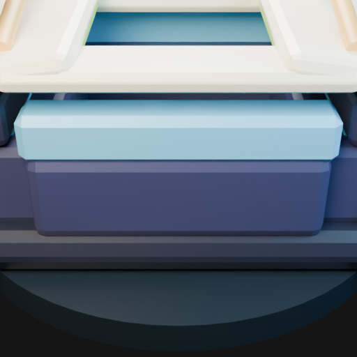
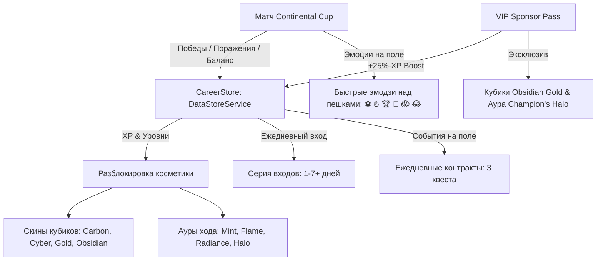
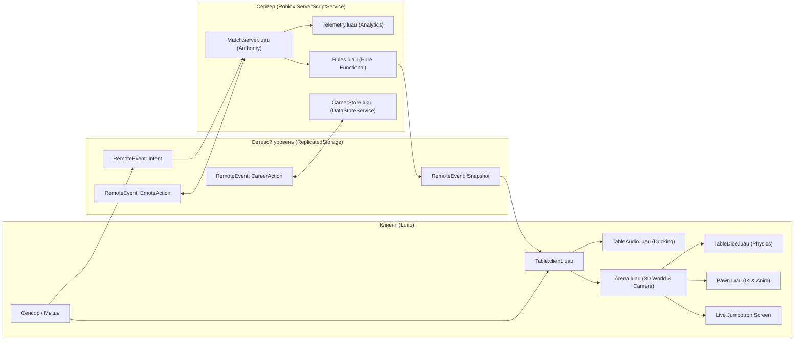

# Soccerpoly (Мировой Драфт) • AAA Football Strategy for Roblox

<div align="center">


[](src/)
[](tests/)
[](art/)
[](default.project.json)
[](scripts/studio-qa.py)

**Профессиональная пошаговая футбольная монополия-стратегия на платформе Roblox.**  
*Коммерческая архитектура, математически выверенный баланс, процедурный 3D-пайплайн в Blender 4.5 LTS и мета-прогрессия тренера.*

[🎮 Играть на Roblox](https://www.roblox.com/games/114770772027261/Soccerpoly) • [📦 Скачать релизный билд (.rbxl)](dist/Soccerpoly.rbxl) • [🛠 Инструкция разработчика](docs/DEVELOPMENT.md)

</div>

---

## 🌟 Ключевые инженерные решения и инновации

<table align="center">
  <tr>
    <td width="30%" align="center">
      <br/>
      <b>Official Place Icon</b>
    </td>
    <td width="70%">
      <ul>
        <li><b>Авторитетный сервер и снапшот-репликация:</b> Вся игровая математика, генерация случайных чисел, аукционы и валидация ходов выполняются строго на сервере в иммутабельной функциональной модели. Клиенты получают компактные дельта-снапшоты и выполняют сглаженный предиктивный рендеринг.</li>
        <li><b>Zero-External-Asset Blender Pipeline:</b> 3D-модели стадионов 4 уровней (флаг, академия, арена, мегастадион), а также скульптированные головы и формы 6 мировых звезд футбола запечены в бинарные Luau-буферы. Игра полностью автономна и не зависит от модерации внешних мешей Roblox.</li>
        <li><b>Ортонормированная кинематика пешек (IK & Bones):</b> Устранено сжатие и деформация сетки конечностей за счет применения строгого ортонормированного базиса <code>CFrame.fromMatrix</code>, анатомической фиксации плеч и шеи, а также 60 FPS процедурного дыхания.</li>
      </ul>
    </td>
  </tr>
</table>

---

## 🏟️ Визуальный стиль и интерактивное окружение


* **Медиакуб стадиона (Live Stadium Jumbotron):**
  Над северными трибунами арены воздвигнута 30-метровая стальная ферма с широкоформатным LED-дисплеем (`SurfaceGui`, `LightInfluence = 0`). Экран в реальном времени транслирует фазы матча (`ROLL THE DICE`, `TRANSFER AUCTION`, `PENALTY SHOOTOUT`, `CONTINENTAL CHAMPION`), имя активного менеджера, цвет его клуба, текущего лидера по капиталу и бегущую строку лиги.
* **Строительные искры (VFX BuildSparks):**
  При покупке клуба или повышении клубного уровня на клетке поля вспыхивает динамический фейерверк золотых искр в фирменном цвете команды.
* **Свободная камера (Free Orbit & Zoom):**
  Игрок может свободно вращать стол правой кнопкой мыши или тачем (`targetYaw`, `targetPitch`), зумировать колесом (`targetZoom`) с физической кинематической интерполяцией и сбрасывать ракурс кнопкой `⟲`.
* **Аудио-ландшафт с Ducking:**
  Шины `SoundGroup` (Music, Stadium Crowd, Effects) с эквалайзером и автоматическим sidechain-приглушением музыки на 9 dB при ключевых событиях (гол, банкротство, дубль, финальный свисток).

---

## 🎮 Социальные и мета-игровые механики



1. **Карьера тренера (Career & Locker):**
   * Сохранение статистики через `DataStoreService` (`PlayerCareerV1`): сыгранные матчи, победы, кубки, заработанный капитал, серия входов.
   * Система уровней менеджера на основе прогрессивной шкалы опыта ($Level = \lfloor\sqrt{XP / 120}\rfloor + 1$).
2. **Ежедневные контракты (Daily Quests):**
   * Сервер автоматически ротирует 3 ежедневных задания («Сыграть 1 матч», «Подписать 2 клуба», «Улучшить 1 стадион») с выдачей наград в окне карьеры.
3. **Быстрые эмодзи (Pawn Emotes):**
   * Боковая панель с 6 реакциями (⚽, 🔥, 🏆, 👏, 😱, 😂), всплывающими в 3D-пространстве над головой фигурки с плавной анимацией покачивания и затухания.
4. **Монетизация (VIP Sponsor Pass):**
   * Интеграция `MarketplaceService` с возможностью приобретения VIP-пропуска, дающего бонус +25% к опыту тренера и легендарный комплект «Золотой Обсидиан».

---

## 📐 Архитектура проекта



### Структура каталогов

| Каталог / Файл | Назначение |
| --- | --- |
| `src/server/Match.server.luau` | Серверный цикл матча, сетевой арбитраж, таймеры, боты, валидация |
| `src/server/CareerStore.luau` | `DataStoreService`, профили игроков, квесты, VIP, сохранение прогресса |
| `src/server/World.luau` | Процедурная сборка арены, ночное освещение, прожекторы, Джамботрон |
| `src/client/Arena.luau` | Рендерер 3D-сцены, свободная орбитальная камера, Джамботрон, эффекты |
| `src/client/Pawn.luau` | Ортонормированный скелет пешек, позы, анимация бега, warp, дыхание |
| `src/client/TableDice.luau` | Физика броска кубиков, эмаль, инкрустация, 5 стилей скинов |
| `src/client/TableAudio.luau` | Звуковые эффекты, `SoundGroup`, эквалайзер, sidechain ducking |
| `src/client/Table.client.luau` | Главный контроллер интерфейса, окно карьеры, карточки клубов, эмодзи |
| `src/client/Copy.luau` | Локализация интерфейса (Русский / Английский) |
| `src/shared/Board.luau` | Топология доски (32 клетки, 20 клубов, 5 лиг, 4 стадиона) |
| `src/shared/Rules.luau` | Чистая математическая модель правил (покупка, аренда, дубли, банк) |
| `scripts/render_promo.py` | Headless-рендер промо-иконки и баннеров в Blender Cycles |
| `scripts/studio-qa.py` | Автоматизированный запуск тестов в реальном Roblox Studio |

---

## 🧪 Верификация и тестирование

Проект покрыт многоуровневой системой тестов: от проверки типов Luau до симуляций Монте-Карло и сквозных тестов в реальном движке Roblox Studio.

### 1. Компиляция и симуляции баланса (`make test`)
```bash
PATH="$PWD/.tools/bin:$PATH" make test
```
* **57 000 строк кода Luau** в строгом режиме (`--strict`).
* **4 320 сезонов** симуляции рыночной экономики и карточек событий.
* **800 парных сидов**: детерминированное выравнивание шансов победы между фигурами (винрейт каждого персонажа строго в пределах $16.67\% \pm 0.8\%$).

### 2. Сквозные тесты в Roblox Studio (`scripts/studio-qa.py`)
```bash
# Мобильный смоук-тест матча на эмулированном iPhone 7 (русская локализация)
python3 scripts/studio-qa.py --rojo .tools/bin/rojo --device portrait-small --edition ru --matchday

# Арт-тест мешей, текстур и анимаций
python3 scripts/studio-qa.py --rojo .tools/bin/rojo --art
```
Оба теста проходят со статусом `WORLD DRAFT QA PASS WorldDraftSmoke`.

---

## 🚀 Сборка проекта

Для сборки релизного файла плейса используется [Rojo](https://rojo.space/):

```bash
# Сборка бинарного плейса .rbxl
PATH="$PWD/.tools/bin:$PATH" rojo build -o dist/Soccerpoly.rbxl

# Запуск локального сервера синхронизации со Studio
PATH="$PWD/.tools/bin:$PATH" rojo serve
```

Полученный файл `dist/Soccerpoly.rbxl` открывается в Roblox Studio и готов к публикации в один клик.

---

## 👨‍💻 Автор

**Глеб Авершин**  
* GitHub: [@GlebAvershin](https://github.com/GlebAvershin)
* Проект: [Soccerpoly Repository](https://github.com/GlebAvershin/Soccerpoly)
* Плейс на Roblox: [Soccerpoly Experience](https://www.roblox.com/games/114770772027261/Soccerpoly)

*Разработано с акцентом на чистую архитектуру, высокую производительность (60 FPS на мобильных устройствах) и эталонное качество визуального ряда.*
