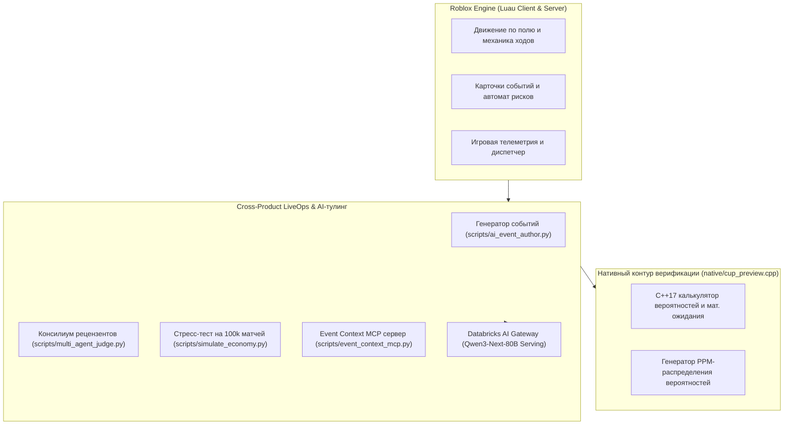

# Soccerpoly · Мировой Драфт & LiveOps Футбольная Стратегия

<p align="center">
  
</p>

<p align="center">
  <a href="README.md"><b>English</b></a> •
  <a href="README.ru.md"><b>Русский</b></a>
</p>

<p align="center">
  
  
  
  
  
  
  
</p>

---

## 🎮 Играть и быстрые ссылки

* ⚽ **[Открыть игру в Roblox](https://www.roblox.com/games/114770772027261/Soccerpoly)** — Опубликованное сезонное событие (*Continental Cup v10*).
* 📦 **[Скачать файл места для Roblox Studio](dist/Soccerpoly.rbxl)** — Готовый `.rbxl` билд.
* 📑 **[Инженерный отчёт и LiveOps архитектура](docs/TECHNOLOGIES.md)** — C++17 инспектор вероятностей, стресс-тест на 100k матчей и оценки моделей.
* 📱 **[Тестирование мобильного UX](docs/QA.md)** — Проверки портретной и ландшафтной верстки.

---

## 📖 Об игре

**Soccerpoly** — пошаговая многопользовательская футбольная стратегия на Roblox. Игроки приобретают футбольные клубы, участвуют в аукционах, развивают инфраструктуру и соревнуются в сезонных кубках, где каждый ход ставит выбор между гарантированной безопасной выплатой и рискованным ударом по воротам.

Soccerpoly демонстрирует сквозной пайплайн производства и балансировки LiveOps:
1. AI-агенты генерируют новые сезонные события на основе брифов (*Champions Derby*).
2. Детерминированные математические валидаторы проверяют инварианты баланса до попадания в билд.
3. Нативные модули на C++17 независимо вычисляют вероятности и математические ожидания.
4. Симулятор макроэкономики проводит стресс-тестирование на 100 000 матчей для защиты от гиперинфляции.
5. Мультиагентный совет рецензентов (LLM-as-a-Judge) оценивает баланс, UX и монетизацию.

---

## 🏗️ Архитектура системы



---

## 🔬 Ключевые инженерные и AI разработки

| Компонент | Техническая реализация | Практическая верификация |
| :--- | :--- | :--- |
| **LiveOps Event Studio** | AI-пайплайн компиляции двуязычного JSON-каталога в код Luau (`EventCards.luau`). | Строгие инварианты: $79.17 \le \text{Safe Cash} (80) \le 124.17$ CR; шанс гола $\le 50.0\%$. |
| **C++17 движок вероятностей** | Независимый C++ калькулятор на STL для расчёта шансов гола и математического ожидания выплат. | Шанс гола = **0.500**, EV Cash = **71.667 CR**, EV Portfolio = **111.667 CR**. |
| **Стресс-тест на 100k матчей** | Monte Carlo симуляция 10 000 игроков на 14-дневном турнире с учётом взносов и стоков валюты. | **Faucet / Sink: 1.0305 – 1.0407** (норма 1.00–1.15). Коэффициент Джини: **0.39–0.42** (без инфляции). |
| **Консилиум LLM-as-a-Judge** | Совет 3 специализированных агентов (Экономист, UX-директор, LiveOps-лид) на Databricks Serving. | Расчёт индекса **PPRS (58.0/100)**; выявлена фрустрация от штрафа -35 CR, дана рекомендация механики серий. |
| **Протокол контекста (MCP)** | Stdio MCP инструмент для запроса правил событий и расчёта рекомендаций агентами. | Инструмент `recommend_cup_action(target)` протестирован по всем 141 целым порогам кредитов. |

---

## 📊 Результаты верификации и измерений

### 1. Стресс-тест макроэкономики на 100 000 матчей

| Метрика | Continental Cup v1 | Champions Derby v1 (Новый LiveOps) | Целевой коридор |
| :--- | :---: | :---: | :---: |
| Общая эмиссия валюты (Faucet) | 11 028 175 CR | 11 506 295 CR | — |
| Общий вывод валюты (Sink) | 10 701 445 CR | 11 056 640 CR | — |
| **Коэффициент инфляции (Faucet / Sink)** | **1.0305** | **1.0407** | **1.00 – 1.15 (Норма)** |
| Коэффициент Джини (Неравенство) | 0.4290 | 0.3910 | < 0.50 (Сбалансированное) |
| Выкуплено сезонных трофеев | 56 182 | 51 042 | Высокая вовлеченность |
| **Статус Guardrail алертинга** | **PASSED** | **PASSED** | Нуль аномалий инфляции |

### 2. Дискретные рекомендации Event Studio (141 порог)

```
Не хватает кредитов | Рекомендация    | Вероятность | Обоснование правила
--------------------+-----------------+-------------+-----------------------------------------------
1 - 75 CR           | Взять гарантию  | 100%        | Гарантия (75 CR) полностью покрывает цель без риска
76 - 140 CR         | Пробить по мячу | 50% (3/6)   | Только гол (140 CR) позволяет закрыть дефицит
141+ CR             | Отложить покупку| 0%          | Превышает максимальную выплату за один ход
```

---

## 🛠️ Воспроизведение и запуск тестов

### Проверка инвариантов экономики и компиляция каталога Luau
```bash
python3 scripts/event_studio.py check
```

### Запуск C++17 калькулятора вероятностей
```bash
python3 scripts/native_preview.py
```

### Запуск стресс-теста макроэкономики на 100 000 матчей
```bash
python3 scripts/simulate_economy.py
```

### Запуск мультиагентного консилиума рецензентов
```bash
python3 scripts/multi_agent_judge.py
```

---

## 📁 Структура репозитория

```
Soccerpoly/
├── content/                # Версионированные каталоги сезонных событий
│   ├── continental-cup.json# Выпущенный Continental Cup v1
│   └── champions-derby.json# AI-синтезированный Champions Derby v1
├── native/                 # C++17 контур верификации
│   ├── cup_preview.cpp     # Расчёт вероятностей и математического ожидания
│   └── Makefile            # Конфигурация нативной сборки
├── scripts/                # LiveOps тулинг и симуляторы
│   ├── ai_event_author.py  # Генеративный AI-пайплайн с проверкой инвариантов
│   ├── simulate_economy.py # Симулятор макроэкономики на 100k матчей
│   ├── multi_agent_judge.py# Консилиум рецензентов LLM-as-a-Judge
│   ├── event_studio.py     # Валидатор и компилятор каталога в Luau
│   └── event_context_mcp.py# Сервер Model Context Protocol
├── src/                    # Клиентский и серверный код Roblox Luau
├── tests/                  # Тесты баланса и правил игры
└── docs/                   # Инженерная документация
    ├── TECHNOLOGIES.md     # Полный отчёт об архитектуре и исследованиях
    └── evidence/           # Сырые квитанции, стресс-тесты и вердикты совета
```

---

<p align="center">
  <sub>Открытое исследование игровой экономики и мультиагентной балансировки LiveOps.</sub>
</p>
