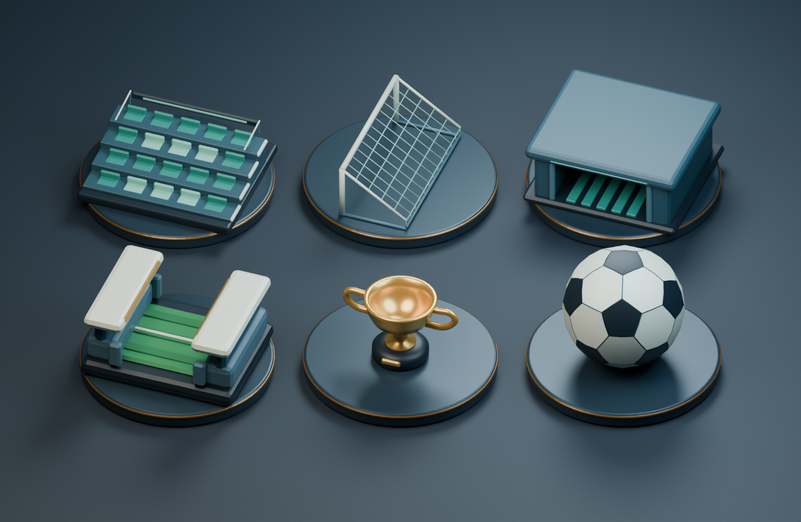

# Continental Cup v0.9

Внутри контура из 24 клеток стоит настольный стадион с размеченным газоном, воротами, рядами сидений, тоннелями и прожекторами. В лобби выбранная фигурка стоит на газоне в увеличенном масштабе. В матче центр освобождается для коротких повторов ударов.

| Что | Решение |
| --- | --- |
| Арена | Графитовый подиум, светлые эмалевые клетки, зелёное поле и небольшие объёмные предметы на клетках событий. Для фокуса на газоне камера меньше повёрнута вокруг поля. |
| Типографика | Roblox Builder Sans и текст в экранном пространстве. Он привязан к проекции клетки и читается горизонтально. На компактном экране показывается код, полное название всегда есть в карточке клетки и в выборе маршрута. |
| Фигурки | Шесть оригинальных моделей с индивидуальными деталями формы, лиц, причёсок и аксессуаров. Голова, корпус, руки и ноги имеют отдельные точки поворота. |
| Движение | Перенос веса, шаги, разворот и приземление. Дежурная анимация выбранной фигурки и празднование гола. На стадионе показываются разные траектории гола, сейва и офсайда. Сокращённая анимация отключает эти эффекты. |
| HUD | Контрастная таблица игроков, две маршрутные карточки с номером, пунктом назначения и ценой действия. Уведомления о событиях меньше и смещены к краю. |

В публичном трейлере и скриншотах Business Tour читаемость доски поддерживают светлые клетки, отделённые от центра объёмные миниатюры и короткие акценты на итогах действий. Эти приёмы перенесены в футбольную сцену с оригинальной геометрией. [Материалы 8Floor в Steam](https://store.steampowered.com/app/397900/Business_Tour/?l=english).

Геометрия размещается в `src/server/World.luau`. Подписи ячеек проецируются в `src/client/BoardLabels.luau`. Модели и движения интегрированы в `src/client/Pawn.luau` и `src/client/Arena.luau`. Использованы навыки работы с ассетами, HUD, камерой и движением из [gamedev-skills](https://github.com/gamedev-skills/awesome-gamedev-agent-skills).

## Как показать Blender в портфолио



| Исходник | Что из него использует Roblox |
| --- | --- |
| [Стадион и реквизит](../art/stadium-kit.blend) | 14 форм, включая корпус и ячейки стола, трибуну, ворота, тоннель, скамейку, башню освещения, мяч, кубок, две ступени клубного стадиона и варианты причёсок и кепки. Материалы передаются как цвета граней. |
| [Фигурки](../art/pawn-shapes.blend) | Четыре общих формы головы, футболки, шорт и бутс. Варианты формы и кожи назначаются в игре. |
| [Анимация фигурки](../art/pawn-motion.blend) | Ключи ожидания, бега и празднования на шести шарнирах. В Roblox проигрываются экспортированные кватернионы и смещения. Положение фишки на доске определяет состояние партии. |

Все модели и клипы из таблицы созданы для проекта. Источники открываются в Blender 4.5 LTS. Чтобы повторить экспорт после изменения объектов или ключей, сохраняйте их имена и диапазоны клипов на шкале времени.

```sh
blender_app=/Applications/Blender.app/Contents/MacOS/Blender
"$blender_app" -b art/stadium-kit.blend -t 2 --python-exit-code 1 --python scripts/make-stadium-art.py -- --export
"$blender_app" -b art/pawn-motion.blend -t 2 --python-exit-code 1 --python scripts/make-pawn-motion.py -- --export
"$blender_app" -b -t 4 --python-exit-code 1 --python scripts/render-stadium-kit.py
make build
python3 scripts/studio-qa.py --art
```

Клиент последовательно запекает формы в `DataModelContent`, освобождает редактируемый меш и повторно использует по одному шаблону на форму. При отсутствии доступа к Mesh API остаются запасные модели Roblox. Для показа детальных моделей в опубликованном плейсе требуется настройка Mesh / Image APIs. [Документация Roblox](https://create.roblox.com/docs/reference/engine/classes/EditableMesh).

Сравните исходники и рендер с [кадром лобби из Roblox Studio](../art/studio-stadium-v090.png) и [кадром Matchday](../art/studio-matchday-v090.png). В исходнике анимации видны ключи шагов, в игре тот же клип переносится на выбранную фигурку и разворачивается по маршруту.

## Фигурки v0.8.1

Голова, футболка, шорты и бутсы собраны в Blender 4.5 LTS. Откройте [pawn-shapes.blend](../art/pawn-shapes.blend), чтобы изменить форму. Команда ниже повторно экспортирует геометрию для Roblox из сохранённой сцены.

```sh
blender_app=/Applications/Blender.app/Contents/MacOS/Blender
"$blender_app" -b art/pawn-shapes.blend -t 2 --python-exit-code 1 --python scripts/make-pawn-meshes.py -- --export
make build
```

Движок собирает по одному шаблону на форму на клиенте и повторно использует его на всех фигурках. Если `EditableMesh` недоступен, фигурка использует запасную геометрию с теми же шарнирами и анимациями.

## Архивная версия

# Continental Cup v0.3

В [Business Tour](https://store.steampowered.com/app/397900/Business_Tour/) ячейки светлее поверхности, объекты собственности выступают над плоскостью, а исход действия получает отдельный визуальный акцент. В Footbolapolia эти решения перенесены в стилистику настольного футбольного стадиона. Для арены использованы собственные детали Roblox и маска суши Natural Earth.

| Элемент | Как работает в игре |
| --- | --- |
| Арена | Кубковый стол со светлой картой, рельефом суши, подсветкой маршрутов, трибунами и двумя тренировочными полями. |
| Клетки | На клубных плашках крупно указано полное название клуба. Под ним стоят код клуба и цена. Отдельные клетки показывают названия событий. Клик или касание открывают карточку с городом и актуальным состоянием клуба. |
| Ход | Маркеры 1 и 2 на поле соответствуют кнопкам, где видны длина маршрута, пункт назначения и последствия. Фигурка разворачивается перед ходом, прыгает по клеткам и останавливается с коротким акцентом при касании. |
| События | Подписание, стадион, полная лига, карта тактики и финал получают краткую плашку поверх поля. Для гола, сейва и офсайда траектории мяча отличаются. |
| Доступность | Нижняя панель на широком экране, увеличенная нижняя панель в портрете, боковая панель на коротком широком экране. Режим сокращённой анимации следует настройке Roblox и доступен в правилах. Маркеры маршрута различаются цифрой и цветом. |

Макет, материалы и типографика поля находятся в `src/shared/Presentation.luau` и `src/server/World.luau`. Камера и движение фигурок работают в `src/client/Arena.luau`. Плашки событий и миниатюра удара живут в `src/client/ResultBanner.luau`. Иконка и обложка находятся в `art/`.

В работе использованы навыки `create-game-assets`, `game-feel`, `game-ui-ux`, `camera-systems`, `roblox-ui` и `roblox-studio-workflow` из [gamedev-skills](https://github.com/gamedev-skills/awesome-gamedev-agent-skills).
